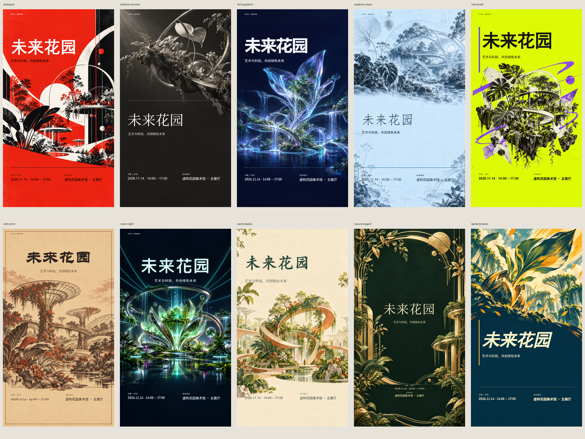
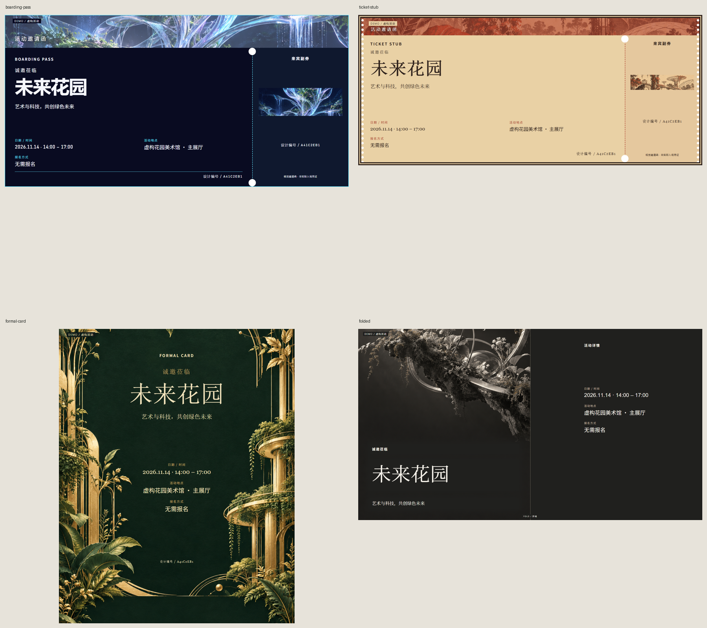

# EventCraft

**Turn event information into a complete campaign: ten design systems, three recommendations, one batch of deliverables.**

[中文](README.md) · [Releases](https://github.com/cagedb1rd/EventCraft/releases) · [Style Gallery](docs/style-gallery.md) · [Codex Skill guide](docs/skill-usage.md) · [MIT License](LICENSE)

## Ten independent design systems



| ID | Style | Structure and use |
|---|---|---|
| swiss-grid | Swiss grid | Index axis, asymmetric grid; lectures and forums |
| editorial-minimal | Editorial minimal | Masthead, offset composition, whitespace; art and culture |
| tech-gradient | Tech gradient | Event-relevant glass sculpture and optical structures, natural dark space; technology |
| academic-clean | Academic professional | Event-relevant research drawings, serif hierarchy and pale space; research |
| neo-brutal | Neo brutalism | Experimental collage, heavy type and asymmetry; recruitment and markets |
| retro-print | Retro print | Event-relevant print imagery, letterpress texture and retro type; music |
| neon-night | Neon nightlife | Event-relevant stage lighting and restrained luminous type; nightlife |
| warm-playful | Warm illustrated | Thematic illustration, native handwritten character and warm space; families |
| luxury-elegant | Luxury elegant | Embossed Art Deco foil, ceremonial axis; weddings and dinners |
| sports-dynamic | Sports dynamic | Relevant competitive elements, painted movement and heavy italic type; sports |

[Complete Gallery](examples/visual-v3/index.html) · [PNG/PDF index](docs/style-gallery.md). Posters default to title, one short supplied subtitle, natural date/time and venue. Useful CTA/brand details are optional. A URL alone does not create a QR; explicit scan intent or `qr_policy=show` is required. Pre-generation composition reserves natural negative space; transparent typography integrates with the actual image. Detailed information remains in invitations and copy. [Title stress comparison](examples/visual-v3/title-gallery.png)

Complete examples: [lecture](examples/generated/lecture/preview.html), [launch](examples/generated/launch/preview.html), [birthday](examples/generated/birthday/preview.html), [formal dinner](examples/generated/dinner/preview.html), [sports](examples/generated/sports/preview.html). GitHub does not execute the HTML previews; download them to view offline. PNG and PDF files can be viewed directly.

```sh
eventcraft gallery --output output/gallery
python scripts/generate_examples.py
python scripts/generate_style_gallery.py
python scripts/build_title_showcase.py
```

## About EventCraft

EventCraft is an installable Agent Skill and a standalone Python CLI. The Codex Agent uses built-in `image_gen` for original key visuals; Chromium typesets exact facts and QR codes. No OpenAI API key is required. Offline CLI previews can reuse bundled original art and record that provenance. Every public example is a fictional Demo.

Current source version: **1.1.0**. Plan composition from event meaning, title length and output ratio before generating original art. Each style defines artistic medium, Chinese/English typography and layout. [Architecture](docs/visual-architecture.md) · [Verification](docs/verification-visual-v3.md) · [Release notes](docs/release-notes-1.1.0.md). Published assets may lag the source; check the downloaded version.

## Deliverables and features



| Deliverable | Format |
|---|---|
| Portrait poster | 1080 × 1920 PNG |
| Social square | 1080 × 1080 PNG |
| Visual invitation | Boarding pass 1600×800, ticket 1600×700, formal card 1080×1350, folded spread 1800×1000 PNG |
| Print files | A4 poster/letter, native-ratio invitation PDF, two-page folded exterior/interior PDF |
| Promotional copy | Short copy, social post, event notice, invitation text |
| Editable sources and audit | HTML, event.json, manifest.json, offline preview |

- Three real previews selected from ten styles, with reasons and tradeoffs.
- Numbered choices, automatic selection, another batch, explicit styles and saved state.
- A single event record supplies facts to every deliverable; essential missing facts require confirmation.
- Logos, hero images, speaker photos, QR assets and visual references; headings adapt to measured title width.

## Downloads and releases

- **Source and full examples**: clone this repository or use **Code → Download ZIP**.
- **Installable Skill ZIP**: check [Releases](https://github.com/cagedb1rd/EventCraft/releases) for the maintainer-uploaded `eventcraft-skill-1.1.0.zip` asset. The compact default includes instructions, runtime code, ten original preview assets, design guides and input samples. Full campaign galleries remain in source, or can be packaged separately with `--with-examples`. GitHub's automatic **Source code (zip)** is a source snapshot. If no release asset is available, build the skill archive using the instructions below.
- **Python CLI**: `.whl` / `.tar.gz` release assets install the Python package; installing a wheel alone does not register a Codex skill.

The Skill ZIP excludes Python environments, Chromium, system fonts and API credentials. Runtime dependencies must still be installed.

## Install and generate your first campaign

Requirements: **Python 3.11+, Chromium and a CJK font**. Windows usually provides Microsoft YaHei/SimSun; macOS provides system CJK fonts; Linux should install Noto CJK. Fonts are not distributed with the project.

Download and extract the source using **Code → Download ZIP**, or copy this repository's Git URL:

```sh
git clone https://github.com/cagedb1rd/EventCraft.git eventcraft
cd eventcraft
```

The public repository is `cagedb1rd/EventCraft`. Run all following commands from the directory containing `pyproject.toml` and `SKILL.md`.

### Windows PowerShell

Use virtual-environment executables directly; activation is not required:

```powershell
python -m venv .venv
.\.venv\Scripts\python.exe -m pip install -e .
.\.venv\Scripts\python.exe -m playwright install chromium
.\.venv\Scripts\eventcraft.exe all examples/inputs/lecture.json --auto-style --output output/lecture
Start-Process .\output\lecture\preview.html
```

### macOS / Linux

```sh
python3 -m venv .venv
source .venv/bin/activate
python -m pip install -e .
python -m playwright install chromium
eventcraft all examples/inputs/lecture.json --auto-style --output output/lecture
```

These CLI commands are offline smoke examples using bundled art; they do not invoke ImageGen. Use the Codex Skill workflow below for fresh event-specific visuals. Open `output/lecture/preview.html` in a browser. Installing dependencies and Chromium requires network access; base template generation is local. Windows can fall back to installed Chrome/Edge. `EVENTCRAFT_BROWSER` sets an explicit browser executable path.

**In the CLI examples below, Windows users should replace `eventcraft` with `.\.venv\Scripts\eventcraft.exe`. macOS/Linux users can use it directly in the activated environment. Run Python scripts with the same virtual environment.**

## Use in Codex

Install Python dependencies first, then register the complete skill, including runtime code, configuration, guides and assets. Copying only `SKILL.md` is insufficient.

Place the downloaded complete Skill ZIP under the project's `dist/` directory. If you already have the ZIP, skip the packaging command below; the extraction steps are identical. Otherwise, build it from source.

Windows PowerShell:

```powershell
# Skip the next line if you downloaded the complete Skill ZIP
.\.venv\Scripts\python.exe scripts/package_skill.py
New-Item -ItemType Directory -Force -Path "$env:USERPROFILE\.agents\skills" | Out-Null
Expand-Archive -LiteralPath ".\dist\eventcraft-skill-1.1.0.zip" -DestinationPath "$env:USERPROFILE\.agents\skills"
```

macOS/Linux, in the activated virtual environment:

```sh
# Skip the next line if you downloaded the complete Skill ZIP
python scripts/package_skill.py
mkdir -p "$HOME/.agents/skills"
unzip dist/eventcraft-skill-1.1.0.zip -d "$HOME/.agents/skills"
```

The installed manifest should be at `~/.agents/skills/eventcraft/SKILL.md`. These commands are for first-time installation; check existing installations before updating. Restart Codex if the skill does not appear. [Official skill documentation](https://learn.chatgpt.com/docs/build-skills) · [Full usage guide](docs/skill-usage.md)

Open the project directory in Codex and send:

```text
Use $eventcraft.
Read examples/inputs/lecture.json as a fictional demo.
Recommend three styles with actual previews, then wait for my selection before generating the complete campaign.
Use the current project's .venv environment to run the CLI.
```

Reply with a number, “another batch”, “choose automatically” or a style name. For your own activity, supply event text or documents; the Agent confirms essential facts before generating. Without global installation, you can explicitly ask Codex to read the project's root `SKILL.md` and follow its workflow.

## CLI recommendations and your own event

```sh
eventcraft recommend examples/inputs/lecture.json --output output/selection
# Open output/selection/recommendations.html, then choose option 2
eventcraft all examples/inputs/lecture.json --select 2 --state output/selection --output output/chosen
eventcraft recommend examples/inputs/lecture.json --output output/selection --next
eventcraft render examples/inputs/lecture.json --style retro-print --output output/retro
```

The selection directory stores ranking and current numbered choices. Editing event facts invalidates old choices. Three options are shown by default; `--all` requests every style. Ranking is an explainable engineering heuristic, with hard brand constraints and configurable weights. [Algorithm](docs/style-recommendation.md) · [Actual CLI transcript](docs/recommendation-terminal.txt)

Store personal event input under the Git-ignored `private/` directory. Start from the [JSON example](examples/inputs/lecture.json) and [event contract](references/event-schema.md). Provide a real title, date/time, IANA timezone, venue or online platform, and registration method. Remove irrelevant sample facts, replace the `example.org` URL, and set `demo` to `false` for a real activity.

```sh
eventcraft all private/event.json --auto-style --output output/my-event
eventcraft extract examples/inputs/lecture.md --output output/extracted/event.json
eventcraft all examples/inputs/lecture.md --interactive --output output/interactive
```

Inputs include JSON, text/Markdown/TXT, DOCX, text-layer PDF and optional Tesseract screenshots. Offline extraction uses conservative labeled fields and regular expressions. Ambiguous or implicit facts need confirmation; `--draft` creates visibly marked unfinished work. Chinese is the default; `--language en` uses English labels/copy and `bilingual` accepts supplied mixed text. Event facts are not automatically translated.

## Built-in image generation and references

The installed Skill directs the Agent to actually invoke built-in `image_gen`, inspect the image and import it. Python does not impersonate the host tool:

```sh
eventcraft art-plan examples/inputs/web-summit.json --style tech-gradient --output output/art-plan.json
# Codex reads plan.prompt, actually calls image_gen and inspects the returned image.
eventcraft art-import output/art-plan.json --image <actual-generated-file> --output output/art-v1
eventcraft all examples/inputs/web-summit.json --style tech-gradient --visual-receipt output/art-v1/receipt.json --require-art --output output/web-summit
```

Each new event needs a fresh concept and actual generation. Plans reserve natural text space and typography before the call. Use `art-plan --ratio square` or `--ratio print` for alternate compositions and save imported receipts in `assets.visual_variants`.

`--require-art` prevents silent bundled-art substitution. Receipts bind event facts, style and image hash. An unavailable host tool is reported explicitly; paid fallback requires authorization. [Portable bridge](references/image-generation.md) · [Same style, different themes](examples/visual-v3/dynamic-comparison.png) · [Isolated Skill result](examples/visual-v3/installed-runtime/preview.html)

```sh
eventcraft render examples/inputs/dinner.json --style luxury-elegant --style-reference examples/inputs/palette.png --style-description 'Luxury elegant, fine lines and whitespace' --output output/custom
```

Use up to five references. Offline CLI analysis extracts palette data only. The Codex Agent actually views references and studies composition/material/design language before creating original art. `style_override.json` persists reproducible parameters and reference hashes without embedding private reference images. Photos/logos preserve proportions; original QR content is retained, and explicit scan intent or qr_policy=show creates a real QR from the supplied URL.

Optional official OpenAI adapters support extraction, reference vision and abstract hero-image generation. They require `OPENAI_API_KEY`, explicit `--allow-network` and potentially paid API usage.

```sh
eventcraft extract examples/inputs/lecture.md --llm --allow-network --output output/model-event.json
eventcraft render examples/inputs/dinner.json --style-reference examples/inputs/palette.png --vision --allow-network --output output/vision
eventcraft render examples/inputs/launch.json --auto-style --generate-hero 'Original abstract orbital sculpture, no text' --allow-network --output output/with-art
```

Template examples do not depend on these APIs. External request contracts and error branches have offline tests; live paid calls have not been verified. [Provider configuration and limits](docs/providers.md)

## Output and verification

```text
output/<activity>/
├── poster_portrait.png, poster_square.png, invitation.png
├── poster_print.pdf, invitation_print.pdf, invite_letter.pdf
├── invitation_outside.png, invitation_folded_print.pdf  # folded format
├── copy/
│   └── short.txt, social.md, formal.md, invitation.txt
├── event.json, manifest.json, preview.html
├── *.html
└── registration_qr.png, style_override.json  # when applicable
```

The manifest records hashes, dimensions, platform fonts, title structure/line count, text bounds, fact checks and selection state. Checks cover text clipping, section overlap, image loading, PDF pages and contrast. Essential text that cannot fit at minimum sizes causes an explicit error.

[Verification](docs/verification-visual-v3.md) records 15 real ImageGen calls, 16 campaign packages and 60 PDFs/66 pages. A full run passed 111 tests; later relevant regressions passed 23 tests and final contracts passed 6. These are separate runs. [Historical verification](docs/verification.md) retains earlier results. Cross-platform, live OCR and paid API acceptance remain unverified. Check remote CI for the actual release commit.

## Privacy, limitations and troubleshooting

- Base rendering does not fetch remote assets. `private/`, `output/` and `.env` are Git-ignored; check any other personal-input paths before committing.
- `--input-root` restricts input/asset paths; documents and images have size limits. Registration URLs are syntax checked, not checked for business validity.
- Scanned PDFs need Agent vision or transcription. Screenshot OCR requires optional dependencies, Tesseract and `chi_sim+eng`; live OCR verification is outstanding.
- Install CJK fonts if Chinese text is missing. Platform font fallbacks can change glyphs and line breaks.
- A4 PDFs are RGB browser-print files with vector text, without CMYK conversion, bleed or print-shop calibration.
- Rerun `recommend` after a stale numbered choice. Resolve ambiguous input through structured JSON or Agent confirmation.

## Development and contribution

```sh
python -m pip install -e '.[dev]'
python -m ruff check eventcraft scripts tests
python scripts/validate_skill.py
python -m pytest -q
python -m build
```

GitHub Actions is configured for lint, skill validation, tests, an offline campaign smoke test and builds on push/PR. Exact development dependencies are in `requirements-dev.lock`. [Contribution guide](CONTRIBUTING.md) · [Architecture](docs/architecture.md) · [Design system](docs/design-system.md) · [Design research](docs/design-research.md) · [Maintainer release guide](docs/release.md)

Code and original graphics are [MIT licensed](LICENSE). System fonts and third-party artwork are not bundled; dependencies retain their own licenses. [Third-party notices](THIRD_PARTY_NOTICES.md)
