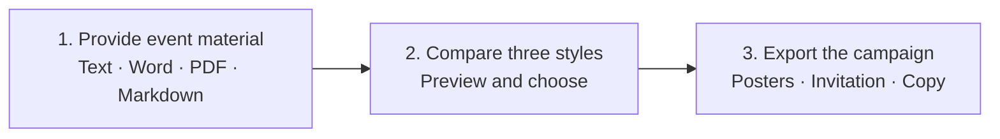

# EventCraft

**An AI poster and event campaign Skill: ten independent visual design systems, with posters, invitations, and promotional copy in one export.**

[中文](README.md) · [Download Skill](https://github.com/cagedb1rd/EventCraft/releases/latest) · [Gallery](docs/style-gallery.md) · [Detailed guide](docs/skill-usage.md)

## One brief. A complete campaign.

Here is a fictional botanical art exhibition, “未来花园 / Future Gardens”. Send the original event notice:

> On November 14, 2026, from 14:00 to 17:00 China Standard Time, Future Gardens brings plant and ecological art to the fictional Garden Art Museum's main hall. It is for designers and students, with no registration required. The theme is “Art and technology, creating a greener future”, with plants and future ecological gardens as the visual direction. This is a fictional Demo.

The corresponding Chinese brief is linked below. Its actual recommendations are **Editorial Minimal → Swiss Grid → Tech Gradient**. Choosing the third style gives a poster, a boarding-pass invitation, and copy with the same facts and visual theme:

| Portrait poster | Visual invitation |
|---|---|
| [](examples/visual-v3/tech-gradient/poster_portrait.png) | [](examples/visual-v3/invitations/boarding-pass/invitation.png)<br><br><strong>Generated copy</strong><br>未来花园<br>2026.11.14 · 14:00 – 17:00<br>虚构花园美术馆 · 主展厅<br>无需报名 |

[Original Chinese brief](examples/inputs/garden.md) · [Social copy](examples/readme-demo/social.md) · [Case provenance](examples/readme-demo/README.md)

<details>
<summary>See the three actual recommended previews</summary>

| 1 · Editorial Minimal | 2 · Swiss Grid | 3 · Tech Gradient |
|---|---|---|
|  |  |  |

These previews were rendered by the current CLI using bundled original artwork. The final poster and invitation above are existing real acceptance outputs for the same event. New events receive fresh artwork after style selection.

</details>

## Three steps from brief to campaign



Send the original text or file; the Skill extracts the facts. Complete briefs proceed directly, with a combined follow-up only for essential missing or conflicting information. Choose a numbered option, request another batch, select automatically, or name a style.

## Ten independent visual design systems


Each system defines its artistic medium, typography, and composition. Codex creates artwork for your event, then the local renderer adds exact Chinese/English lettering, dates, and venues. Initial style previews use bundled original artwork; fresh artwork is created after you choose a style.

<details>
<summary>Explore all ten styles and their use cases</summary>

| ID | Style | Structure and use |
|---|---|---|
| swiss-grid | Swiss grid | Index axis, asymmetric grid; lectures and forums |
| editorial-minimal | Editorial minimal | Masthead, offset composition, whitespace; art and culture |
| tech-gradient | Tech gradient | Event-relevant glass sculpture and optical structures, natural dark space; technology |
| academic-clean | Academic professional | Event-relevant research drawings, serif hierarchy and pale space; research |
| neo-brutal | Neo brutalism | Experimental collage, heavy type and asymmetry; recruitment and markets |
| retro-print | Retro print | Event-relevant print imagery, letterpress texture and retro type; music |
| neon-night | Neon nightlife | Event-relevant stage lighting and restrained luminous type; nightlife |
| warm-playful | Warm illustrated | Thematic illustration, native handwritten character and warm space; families |
| luxury-elegant | Luxury elegant | Embossed Art Deco foil, ceremonial axis; weddings and dinners |
| sports-dynamic | Sports dynamic | Relevant competitive elements, painted movement and heavy italic type; sports |

</details>

## Quick installation

**Download the Skill, let Codex configure it, then provide your event material.**

1. Download `eventcraft-skill-VERSION.zip` from the [latest Release](https://github.com/cagedb1rd/EventCraft/releases/latest). Extract its entire `eventcraft` folder into `~/.agents/skills/`, or `%USERPROFILE%\.agents\skills\` on Windows. Keep `eventcraft/SKILL.md` and all supporting files together; back up personal changes before updating.
2. Open the extracted `eventcraft` folder in Codex and send the setup prompt below.
3. Once configured, open your event project, select EventCraft, and provide your brief. In the CLI / IDE, use `$eventcraft`.

```text
Configure this EventCraft Skill's local runtime.
Verify the installation with a bundled offline example and return the preview path.
```

<details>
<summary>Requirements, host compatibility, and complete manual setup commands</summary>

EventCraft uses the Agent Skills format with `SKILL.md` as its entry point. This project documents Codex installation and use, with local file and Python execution access; other hosts have not been verified here. [Official skill discovery](https://learn.chatgpt.com/docs/build-skills)

Runtime requirements are **Python 3.11+, Playwright Chromium, and CJK fonts**. Fresh artwork uses the current chat's built-in ImageGen without an OpenAI API key by default. Missing tools are reported. Initial dependency and browser downloads require network access.

The complete commands below install the environment and export an offline demo. The setup demo reuses bundled artwork without a new image generation call.

<details>
<summary>Windows PowerShell</summary>

Run inside the extracted Skill folder:

```powershell
python -m venv .venv
.\.venv\Scripts\python.exe -m pip install -e .
.\.venv\Scripts\python.exe -m playwright install chromium
.\.venv\Scripts\eventcraft.exe all examples/inputs/lecture.json --auto-style --output output/demo
Start-Process .\output\demo\preview.html
```

Windows usually provides Microsoft YaHei / SimSun. System fonts are not bundled.

</details>

<details>
<summary>macOS / Linux</summary>

Run inside the extracted Skill folder:

```sh
python3 -m venv .venv
.venv/bin/python -m pip install -e .
.venv/bin/python -m playwright install chromium
.venv/bin/eventcraft all examples/inputs/lecture.json --auto-style --output output/demo
```

Open `output/demo/preview.html`. macOS provides system CJK fonts. On Ubuntu / Debian, install them with `sudo apt-get install fonts-noto-cjk`. If browser libraries are missing on Linux, run `.venv/bin/python -m playwright install --with-deps chromium`.

</details>

</details>

## Use it with your own material

Paste your event notice, or attach **Word, a text-layer PDF, or Markdown**, and send:

```text
Use EventCraft to turn this event brief into posters, an invitation, and promotional copy.
Start by recommending three styles.
```

Reply “option 3”, “another batch”, or “choose automatically”. If you already know the direction:

```text
Use Swiss Grid with navy and gold branding, and make the invitation a formal card.
Use the logo I attached.
```

Attach logos, speaker photos, artwork, and references in the same chat, or provide a local path such as `private/logo.png`. The Skill manages asset paths and event data; no field form or JSON authoring is required.

Open the returned `preview.html` to see the results. Share the PNGs, print the PDFs, or edit the HTML. Deliverables stay locally and are not automatically published.

<details>
<summary>What files are exported?</summary>

For a campaign saved under `output/my-event/`, the main files are:

```text
output/my-event/
├── preview.html             # Offline campaign preview
├── poster_portrait.png      # 1080×1920 portrait poster
├── poster_square.png        # 1080×1080 social graphic
├── poster_print.pdf         # A4 poster
├── invitation.png           # Selected visual invitation format
├── invitation_print.pdf     # Native-ratio invitation PDF
├── invite_letter.pdf        # Text invitation
├── poster_portrait.html     # Editable poster source
├── invitation.html          # Editable invitation source
├── copy/
│   ├── short.txt
│   ├── social.md
│   ├── formal.md
│   └── invitation.txt
├── event.json               # Shared event facts
└── manifest.json            # Fonts, layout, provenance, and checks
```

Imported artwork includes its image and provenance receipt; folded invitations also include inside/outside artwork and a two-page PDF. [Developer data contract](references/event-schema.md)

</details>

## More capabilities


- **Four invitations:** boarding pass, ticket stub, formal card, and folded invitation, in PNG/PDF.
- **Chinese and English typography:** measured title fitting, natural dates, and optional QR codes.
- **Branding and references:** logos, photos, colors, and visual references with consistent facts across outputs.
- **Editable and inspectable:** HTML, copy, event data, artwork provenance, and font records.

[Individual designs and print samples](docs/style-gallery.md) · [Detailed guide](docs/skill-usage.md)

## Troubleshooting

| Issue | Action |
|---|---|
| Skill is missing | Check `SKILL.md` and the final path; avoid an extra nested folder and restart if needed |
| Command is missing | Use the installed Skill's `.venv`; Windows executables are under `.venv/Scripts/` |
| Missing Chinese glyphs | Install CJK fonts and regenerate |
| No image generation tool | The Agent explains reuse options; it does not silently use a paid API |
| Which asset to download? | The complete Skill ZIP; SHA256SUMS is optional verification, and a wheel is unnecessary |

<details>
<summary>Rendering pipeline, optional APIs, and developer resources</summary>

**Original brief → Agent extraction and recommendations → built-in ImageGen artwork → Playwright/Chromium HTML typesetting → PNG screenshots and PDFs.** Python manages facts, images, QR codes, and copy; Pillow assists image processing. Chromium typesets the text.

The default host tool is not hard-coded to DALL-E, Flux, or Midjourney. Python can render bundled/imported artwork but cannot invoke a chat image tool. Optional OpenAI API adapters require `OPENAI_API_KEY` and explicit `--allow-network`, with no automatic switch. See [provider configuration](docs/providers.md).

[Architecture](docs/architecture.md) · [Event contract](references/event-schema.md) · [Contributing](CONTRIBUTING.md) · [Verification](docs/verification-visual-v3.md)

Automated test source stays in Git for CI; the default Skill ZIP excludes tests, development scripts, and gallery output. Full earlier acceptance artifacts remain in the [v1.1.0 snapshot](https://github.com/cagedb1rd/EventCraft/tree/v1.1.0).

</details>

[MIT License](LICENSE) · [Third-party notices](THIRD_PARTY_NOTICES.md)
