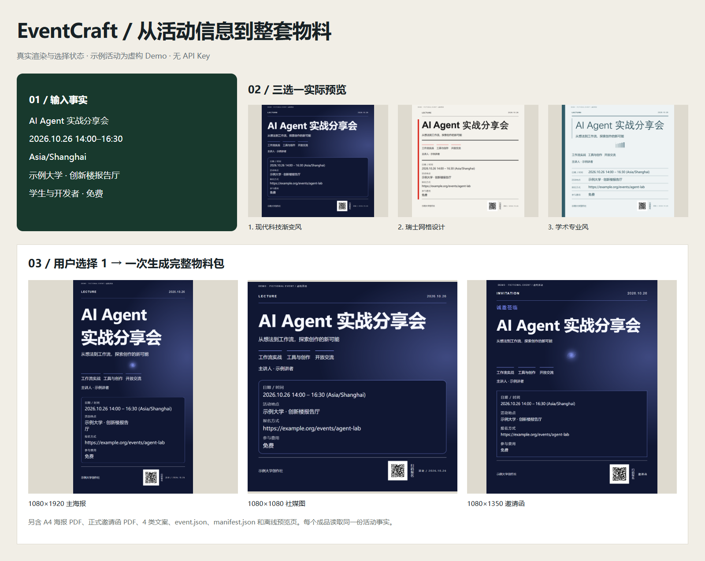
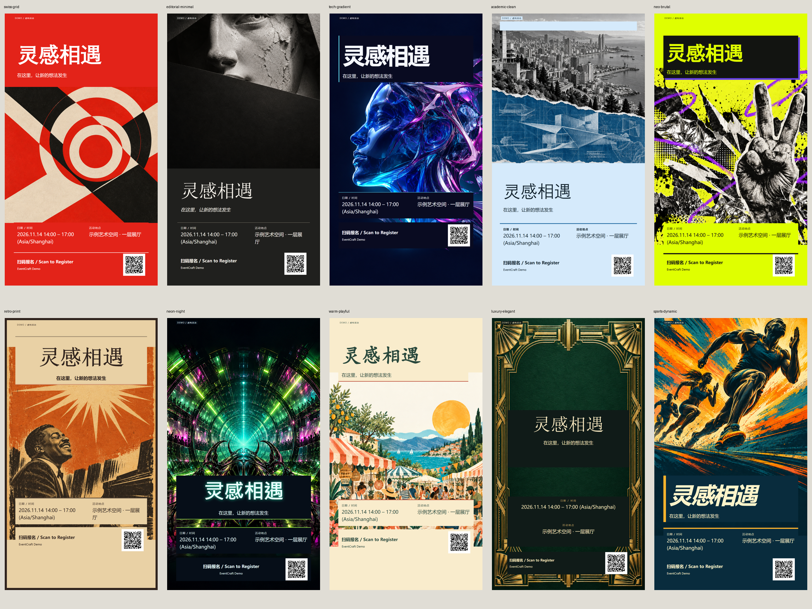

# EventCraft

**把活动资料变成一整套宣传物料：十套风格，智能三选一，确认后一次生成。**

[English](README.en.md) · [Style Gallery](docs/style-gallery.md) · [Codex Skill 使用指南](docs/skill-usage.md) · [MIT License](LICENSE)



EventCraft 是一个可安装的 Agent Skill，也提供独立 Python CLI。基础模式无需 API Key，通过原创 HTML/CSS/SVG 模板和 Chromium 生成海报、邀请函、PDF 与宣传文案。上图及仓库中的所有示例均由本项目真实生成，活动资料为虚构 Demo。

## 可以生成什么

| 产物 | 格式 |
|---|---|
| 竖版主海报 | 1080 × 1920 PNG |
| 社交媒体方图 | 1080 × 1080 PNG |
| 数字邀请函 | 1080 × 1350 PNG |
| 打印海报、正式邀请函 | A4 PDF |
| 宣传文案 | 短文案、社媒帖、活动通知、邀请文字 |
| 可编辑与可核验文件 | HTML 源、event.json、manifest.json、离线预览页 |

- 从十套设计中推荐三个选项，附真实预览、推荐依据和取舍。
- 支持选择、自动选择、换一批、直接指定风格，以及保存和恢复选择状态。
- 海报、邀请函与文案读取同一份活动事实，缺失必填信息时集中确认。
- 支持 Logo、主图、讲者照片、原始二维码和参考图片；标题按实际字宽自适应排版。

## 安装与第一次生成

需要 **Python 3.11+、Chromium 和中文字体**。Windows 通常已有 Microsoft YaHei / SimSun；macOS 使用系统中文字体；Linux 建议安装 Noto CJK。系统字体不随仓库分发。

在本仓库点击 **Code → Download ZIP** 并解压，或复制仓库地址执行：

```sh
git clone <YOUR_REPOSITORY_URL> eventcraft
cd eventcraft
```

`<YOUR_REPOSITORY_URL>` 替换为本仓库的 Git 地址。以下命令均在包含 `pyproject.toml` 和 `SKILL.md` 的项目根目录运行。

### Windows PowerShell

无需激活虚拟环境，直接使用其中的可执行文件：

```powershell
python -m venv .venv
.\.venv\Scripts\python.exe -m pip install -e .
.\.venv\Scripts\python.exe -m playwright install chromium
.\.venv\Scripts\eventcraft.exe all examples/inputs/lecture.json --auto-style --output output/lecture
Start-Process .\output\lecture\preview.html
```

### macOS / Linux

```sh
python3 -m venv .venv
source .venv/bin/activate
python -m pip install -e .
python -m playwright install chromium
eventcraft all examples/inputs/lecture.json --auto-style --output output/lecture
```

在浏览器打开 `output/lecture/preview.html` 查看全部成品。安装依赖和浏览器需要网络；基础模板生成完全在本地执行。Windows 可回退到已安装的 Chrome/Edge，也可通过 `EVENTCRAFT_BROWSER` 指定浏览器可执行文件。

**下文 CLI 示例中的 `eventcraft`：Windows 请使用 `.\.venv\Scripts\eventcraft.exe`；macOS/Linux 在已激活的虚拟环境中直接使用。脚本示例中的 `python` 同样应使用项目虚拟环境。**

## 在 Codex 中使用

先完成上面的 Python 依赖安装，再安装完整 Skill。Skill 包含运行代码、配置、设计规范和资源，不能只复制 `SKILL.md`。

Windows PowerShell：

```powershell
.\.venv\Scripts\python.exe scripts/package_skill.py
New-Item -ItemType Directory -Force -Path "$env:USERPROFILE\.agents\skills" | Out-Null
Expand-Archive -LiteralPath ".\dist\eventcraft-skill-1.0.0.zip" -DestinationPath "$env:USERPROFILE\.agents\skills"
```

macOS/Linux，在已激活的虚拟环境中：

```sh
python scripts/package_skill.py
mkdir -p "$HOME/.agents/skills"
unzip dist/eventcraft-skill-1.0.0.zip -d "$HOME/.agents/skills"
```

安装后应存在 `~/.agents/skills/eventcraft/SKILL.md`。这些命令用于首次安装；已有同名技能时，请先按[使用指南](docs/skill-usage.md)检查和更新。Codex 支持该用户技能目录；若安装后未出现，重启 Codex。[官方技能说明](https://learn.chatgpt.com/docs/build-skills)

在 Codex 打开项目目录，发送：

```text
使用 $eventcraft。
读取 examples/inputs/lecture.json，这是演示活动。
先推荐三种风格并展示真实预览，我选择后再生成整套物料。
运行 CLI 时使用当前项目的 .venv 虚拟环境。
```

看到预览后可回复“选第二个”“换一批”“自动选最优”或指定风格。创建自己的活动时，直接提供活动文字或附件；Agent 会确认必要事实，再推荐和生成。也可以不全局安装，在项目聊天里明确要求 Codex 阅读根目录的 `SKILL.md` 并按其流程执行。

## CLI：推荐、选择与自己的活动

```sh
# 生成三个真实预览
eventcraft recommend examples/inputs/lecture.json --output output/selection
# 打开 output/selection/recommendations.html 后，选择第二项
eventcraft all examples/inputs/lecture.json --select 2 --state output/selection --output output/chosen
# 换一批，不重复当前选项
eventcraft recommend examples/inputs/lecture.json --output output/selection --next
# 直接指定任意内置风格
eventcraft render examples/inputs/lecture.json --style retro-print --output output/retro
```

推荐结果与当前编号保存在选择目录中。活动资料修改后，旧编号选择会失效，需要重新推荐。默认展示三个选项；主动传入 `--all` 才展示全部。评分为可解释的工程规则，支持品牌禁止色/风格等硬约束及自定义权重。[推荐算法](docs/style-recommendation.md) · [真实 CLI 运行记录](docs/recommendation-terminal.txt)

自己的资料建议放在已被 Git 忽略的 `private/` 中。可以参考 [JSON 样例](examples/inputs/lecture.json) 和[数据契约](references/event-schema.md)，提供真实标题、日期、时间、IANA 时区、地点或线上平台、报名方式。删除不适用的示例字段，替换 `example.org` 链接；正式活动将 `demo` 设为 `false`。

```sh
eventcraft all private/event.json --auto-style --output output/my-event
# 从已有文档抽取资料，并集中补充缺失信息
eventcraft extract examples/inputs/lecture.md --output output/extracted/event.json
eventcraft all examples/inputs/lecture.md --interactive --output output/interactive
```

支持 JSON、文本、Markdown、TXT、DOCX、带文本层 PDF，以及可选 Tesseract OCR 截图。无模型的抽取采用字段标签和保守正则；隐含信息与冲突需要确认。`--draft` 允许生成明确标记的草稿。中文默认，`--language en` 使用英文标签与文案；`bilingual` 接受用户提供的中英混排内容，活动事实不会自动翻译。

## 十套独立视觉设计系统



| ID | 风格 | 结构与适用场景 |
|---|---|---|
| swiss-grid | 瑞士网格设计 | 索引轴线、不对称网格；讲座、论坛 |
| editorial-minimal | 编辑杂志极简风 | 刊头、偏置构图、编辑留白；艺术、文化 |
| tech-gradient | 现代科技渐变风 | 空间轨道、信息卡片；科技、发布 |
| academic-clean | 学术专业风 | 机构书脊、细分隔线；学术、培训 |
| neo-brutal | 年轻大胆风 | 硬边模块、撞色贴纸；招新、市集 |
| retro-print | 复古印刷风 | 拱形日晕、纸纹票券；复古、音乐 |
| neon-night | 霓虹夜生活风 | 发光门框、居中标题；夜间音乐、派对 |
| warm-playful | 温暖手绘风 | 原创植物线稿、便笺纸卡；生日、亲子 |
| luxury-elegant | 奢华典雅风 | 礼仪中轴、细线花结；婚礼、晚宴 |
| sports-dynamic | 运动竞技风 | 斜切速度线、真实日期数字；体育、竞技 |

每套风格均有真实海报与邀请函：[完整 Style Gallery](docs/style-gallery.md)。标题使用不同字体栈和字重，按字宽调整结构、平衡换行，保留能放入一行的短词组。[标题长度自适应对照](docs/images/title-adaptation.png)

五套完整案例：[校园讲座](examples/generated/lecture/preview.html) · [科技发布](examples/generated/launch/preview.html) · [生日聚会](examples/generated/birthday/preview.html) · [典雅晚宴](examples/generated/dinner/preview.html) · [运动赛事](examples/generated/sports/preview.html)。GitHub 不会直接执行这些 HTML；下载后可离线打开，PNG 和 PDF 可直接查看。

```sh
eventcraft gallery --output output/gallery
# 重现仓库中的固定案例、画廊与标题对照
python scripts/generate_examples.py
python scripts/generate_style_gallery.py
python scripts/build_title_showcase.py
```

## 参考图与可选 AI 功能

```sh
eventcraft render examples/inputs/dinner.json --style luxury-elegant --style-reference examples/inputs/palette.png --style-description '奢华典雅风，细线与留白' --output output/custom
```

参考图片最多五张。基础模式只提取颜色；布局通过内置风格 ID 或文字偏好指定。`style_override.json` 保存可重放的设计参数与参考哈希，参考原图不会嵌入成品。用户 Logo/照片保留比例，原始二维码保留内容；提供报名 URL 时可以生成真实二维码。

可选官方 OpenAI Provider 支持资料理解、参考图视觉分析和抽象主图生成，需要 `OPENAI_API_KEY` 环境变量及显式 `--allow-network`，可能产生 API 费用。

```sh
eventcraft extract examples/inputs/lecture.md --llm --allow-network --output output/model-event.json
eventcraft render examples/inputs/dinner.json --style-reference examples/inputs/palette.png --vision --allow-network --output output/vision
eventcraft render examples/inputs/launch.json --auto-style --generate-hero 'Original abstract orbital sculpture, no text' --allow-network --output output/with-art
```

模板示例不依赖付费 API。外部请求格式与错误分支有离线契约测试，真实付费调用尚未验证。配置与支持范围见 [Provider 文档](docs/providers.md)。

## 输出与质量检查

```text
output/<activity>/
├── poster_portrait.png、poster_square.png、invitation.png
├── poster_print.pdf、invite_letter.pdf
├── copy/
│   └── short.txt、social.md、formal.md、invitation.txt
├── event.json、manifest.json、preview.html
├── *.html
└── registration_qr.png、style_override.json  # 按需要生成
```

manifest 记录文件哈希、尺寸、实际字体、标题布局/行数、文字边界、事实检查和选择状态。检查覆盖文字越界、模块重叠、图片加载、PDF 页面与对比度。长内容达到最小字号仍放不下时会明确报错。

[验收记录](docs/verification.md)：Windows/Python 3.12/Chrome 下 86 项完整测试通过；五套示例与十风格 Gallery 共 45 张成品 PNG、30 个 PDF。Linux/macOS、真实 OCR、远端 CI 与付费 API 的验证状态详见该报告。

## 隐私、限制与常见问题

- 基础渲染不联网加载素材。`private/`、`output/` 和 `.env` 被 Git 忽略；自己新建的其他资料路径需自行检查是否会被提交。
- `--input-root` 可以限制资料与素材路径；图片和文档有大小上限。报名 URL 只做语法验证，不自动检查业务有效性。
- 扫描 PDF 需要 Agent 视觉或先转录；截图 OCR 需要可选依赖及 Tesseract 的 `chi_sim+eng` 语言包，本机 OCR 验收尚未完成。
- 中文显示异常时安装可用的 CJK 字体。不同平台字体回退会改变字形和换行。
- A4 PDF 是 RGB 浏览器打印文件，保留矢量文字；不提供印刷厂 CMYK、出血和色彩校准。
- 编号选择失效时重新运行 `recommend`。原资料有歧义时，补充规范 JSON 或使用 Agent 集中确认。

## 开发与贡献

```sh
python -m pip install -e '.[dev]'
python -m ruff check eventcraft scripts tests
python scripts/validate_skill.py
python -m pytest -q
python -m build
```

GitHub Actions 在 push/PR 时运行 lint、Skill 校验、测试、无密钥生成烟测和构建。精确开发依赖见 `requirements-dev.lock`。[贡献指南](CONTRIBUTING.md) · [架构](docs/architecture.md) · [设计系统](docs/design-system.md) · [设计研究](docs/design-research.md) · [维护者发布指南](docs/release.md)

代码与原创图形采用 [MIT License](LICENSE)。系统字体和第三方艺术素材不随项目分发；依赖保留各自许可证。[第三方声明](THIRD_PARTY_NOTICES.md)
