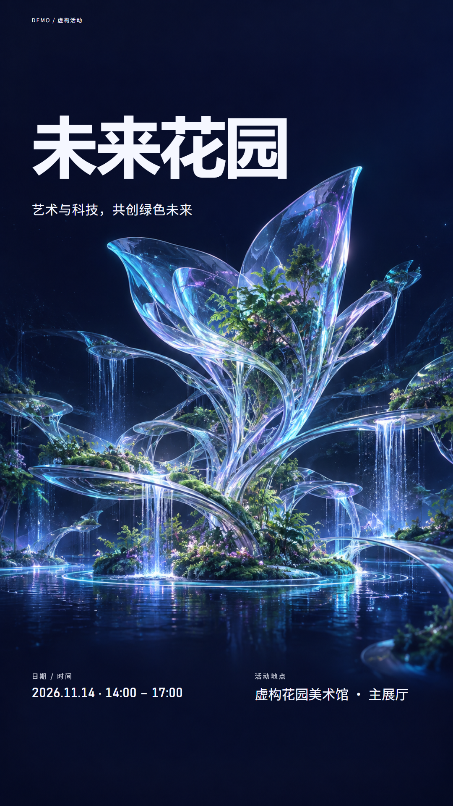
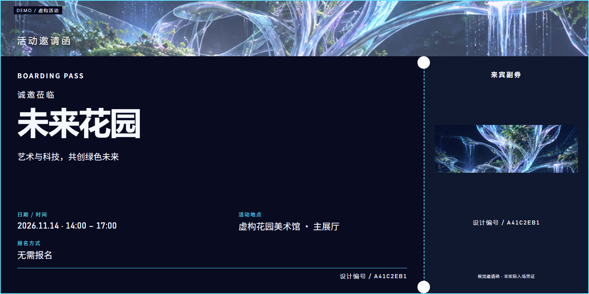
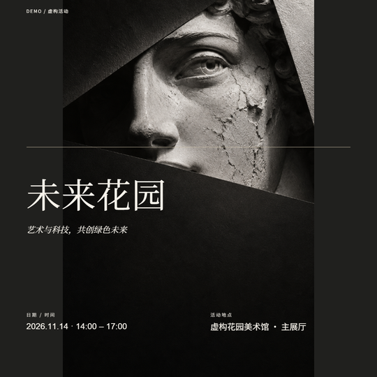
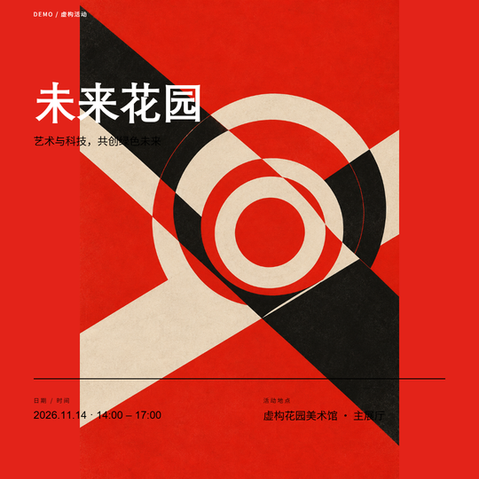
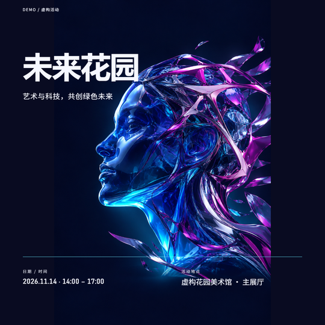
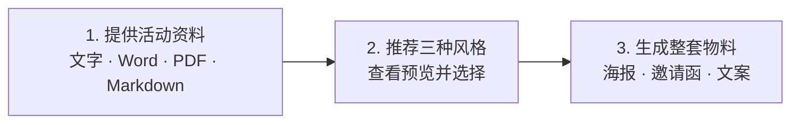

# EventCraft

**AI 海报生成与活动物料 Skill：十套独立视觉设计系统，一次生成海报、邀请函和宣传文案。**

[English](README.en.md) · [下载 Skill](https://github.com/cagedb1rd/EventCraft/releases/latest) · [更多效果](docs/style-gallery.md) · [详细使用指南](docs/skill-usage.md)

## 一份活动资料，一整套成品

以虚构的植物生态艺术展「未来花园」为例，你可以直接发送这样的活动通知：

> 2026 年 11 月 14 日 14:00–17:00（北京时间），在虚构花园美术馆主展厅举办「未来花园」植物与生态艺术展，面向设计师和学生，无需报名。主题是“艺术与科技，共创绿色未来”，希望以植物和未来生态花园为视觉方向。这是虚构 Demo。

Skill 提取活动信息后，推荐 **编辑杂志极简 → 瑞士网格 → 科技渐变**。这个案例选择第三款，得到同一视觉主题的海报、登机牌邀请函和文案：

| 竖版海报 | 视觉邀请函 |
|---|---|
| [](examples/visual-v3/tech-gradient/poster_portrait.png) | [](examples/visual-v3/invitations/boarding-pass/invitation.png)<br><br><strong>短文案</strong><br>未来花园<br>2026.11.14 · 14:00 – 17:00<br>虚构花园美术馆 · 主展厅<br>无需报名 |

[活动原文](examples/inputs/garden.md) · [社媒文案](examples/readme-demo/social.md) · [案例说明](examples/readme-demo/README.md)

<details>
<summary>看看这份资料推荐的三款真实预览</summary>

| 1 · 编辑杂志极简 | 2 · 瑞士网格 | 3 · 科技渐变 |
|---|---|---|
|  |  |  |

推荐预览由当前 CLI 实际渲染，复用随包原创素材。上方最终海报和邀请函来自同一活动的已有真实验收成品；新活动会在选择风格后创作专属主视觉。

</details>

## 三步工作流程



直接发送原文或文件，信息提取由 Skill 完成。资料完整就继续；关键内容缺失或冲突时，才集中补问。风格可以选编号、换一批、自动选最优，也可以直接指定。

## 十套独立视觉设计系统


每套系统都有独立的艺术媒介、字体层级和构图策略。新活动由 Codex 的内置图像工具创作专属主视觉，再由本地渲染器准确排入中英文、日期和地点。三款初始推荐预览使用随包原创素材；选定风格后才创作本次活动的图片。

<details>
<summary>查看十套风格的名称、ID 与适用场景</summary>

| ID | 风格 | 结构与适用场景 |
|---|---|---|
| swiss-grid | 瑞士网格设计 | 索引轴线、不对称网格；讲座、论坛 |
| editorial-minimal | 编辑杂志极简风 | 刊头、偏置构图、编辑留白；艺术、文化 |
| tech-gradient | 现代科技渐变风 | 活动主题相关的玻璃雕塑与光学结构、深色自然留白；科技、发布 |
| academic-clean | 学术专业风 | 主题相关的研究绘图、宋体层级与浅色留白；学术、培训 |
| neo-brutal | 年轻大胆风 | 实验拼贴、极粗标题与非对称构图；招新、市集 |
| retro-print | 复古印刷风 | 主题相关的版画与半调质感、复古标题；复古、音乐 |
| neon-night | 霓虹夜生活风 | 主题相关的舞台光线、克制发光标题；夜间音乐、派对 |
| warm-playful | 温暖手绘风 | 主题插画、楷体气质与温暖留白；生日、亲子 |
| luxury-elegant | 奢华典雅风 | 浮雕金箔 Art Deco、仪式中轴；婚礼、晚宴 |
| sports-dynamic | 运动竞技风 | 主题竞技元素、绘画动势与粗重斜体；体育、竞技 |

</details>

## 快速安装

**下载 Skill，交给 Codex 配置环境，然后提供活动资料。**

1. 在 [最新 Release](https://github.com/cagedb1rd/EventCraft/releases/latest) 下载 `eventcraft-skill-版本号.zip`，将整个 `eventcraft` 文件夹解压到 `~/.agents/skills/`。Windows 对应 `%USERPROFILE%\.agents\skills\`。最终应存在 `eventcraft/SKILL.md` 和全部支持文件；已有安装先备份个人修改。
2. 在 Codex 中打开解压后的 `eventcraft` 文件夹，发送下面的配置指令。
3. 配置完成后打开你的活动项目，选择 EventCraft，发送活动文字或附件。CLI / IDE 中可用 `$eventcraft`。

```text
请配置这个 EventCraft Skill 的本地运行环境，
用随包示例验证安装，并告诉我预览文件的位置。
```

<details>
<summary>环境要求、宿主说明与完整手动安装命令</summary>

EventCraft 使用以 `SKILL.md` 为入口的 Agent Skills 格式，目前提供 Codex 的安装与使用流程。需要本地文件读写和 Python 执行能力；其他宿主尚未在本项目中验证。[官方 Skill 目录说明](https://learn.chatgpt.com/docs/build-skills)

运行依赖为 **Python 3.11+、Playwright Chromium 和中文字体**。原创主视觉使用当前聊天的内置 ImageGen，默认不需要 OpenAI API Key；未提供该工具时会说明限制。首次下载 Python 依赖和浏览器需要联网。

以下完整命令同时完成环境安装和一套离线示例导出。安装示例复用随包素材，不调用新的图像生成。

<details>
<summary>Windows PowerShell</summary>

在解压后的 Skill 文件夹打开 PowerShell：

```powershell
python -m venv .venv
.\.venv\Scripts\python.exe -m pip install -e .
.\.venv\Scripts\python.exe -m playwright install chromium
.\.venv\Scripts\eventcraft.exe all examples/inputs/lecture.json --auto-style --output output/demo
Start-Process .\output\demo\preview.html
```

Windows 通常已有 Microsoft YaHei / SimSun。安装包不附带系统字体。

</details>

<details>
<summary>macOS / Linux</summary>

在解压后的 Skill 文件夹打开终端：

```sh
python3 -m venv .venv
.venv/bin/python -m pip install -e .
.venv/bin/python -m playwright install chromium
.venv/bin/eventcraft all examples/inputs/lecture.json --auto-style --output output/demo
```

打开 `output/demo/preview.html`。macOS 使用系统中文字体；Ubuntu / Debian 可通过 `sudo apt-get install fonts-noto-cjk` 安装中文字体。Linux 缺少浏览器依赖时运行 `.venv/bin/python -m playwright install --with-deps chromium`。

</details>

</details>

## 直接这样使用

粘贴活动原文，或附上 **Word、带文本层的 PDF、Markdown**，再发一句：

```text
使用 EventCraft，根据这份活动资料制作海报、邀请函和宣传文案，先推荐三种风格。
```

看到预览后回复“选第三个”“换一批”或“自动选最优”。有明确偏好时也可以直接说：

```text
使用瑞士网格设计，配色以藏蓝和金色为主，邀请函做成正式卡。
Logo 使用我附上的图片。
```

Logo、讲者照片、主图和参考图可以附在同一聊天，或给出本地文件位置，如 `private/logo.png`。Skill 负责整理图片路径和活动数据，无需你填字段表或编写 JSON。

生成后打开 Agent 返回的 `preview.html`：PNG 用于分享，PDF 用于打印，HTML 可继续编辑。成品留在本地，不会自动上传。

<details>
<summary>生成目录里有哪些文件？</summary>

以输出到 `output/my-event/` 为例，主要文件如下：

```text
output/my-event/
├── preview.html             # 全部成品的离线预览
├── poster_portrait.png      # 1080×1920 竖版海报
├── poster_square.png        # 1080×1080 社媒方图
├── poster_print.pdf         # A4 海报
├── invitation.png           # 所选形式的视觉邀请函
├── invitation_print.pdf     # 邀请函原比例 PDF
├── invite_letter.pdf        # 文字邀请函
├── poster_portrait.html     # 可编辑海报源文件
├── invitation.html          # 可编辑邀请函源文件
├── copy/
│   ├── short.txt
│   ├── social.md
│   ├── formal.md
│   └── invitation.txt
├── event.json               # 同一份活动事实
└── manifest.json            # 字体、布局、素材来源和校验记录
```

导入主视觉时还包含图像和来源凭据；折页额外提供内外展开图与双页 PDF。[开发者数据契约](references/event-schema.md)

</details>

## 更多功能


- **四种邀请函**：登机牌、票券、正式卡和折页，均有 PNG/PDF。
- **中英文排版**：标题按实际字宽适配，日期自然呈现，二维码按需生成。
- **品牌与参考图**：支持 Logo、照片、品牌色和设计参考，海报与文案共享同一份事实。
- **可编辑和可核验**：HTML、文案、活动数据、素材与字体记录一并导出。

[单张成品和打印示例](docs/style-gallery.md) · [详细使用指南](docs/skill-usage.md)

## 常见问题

| 问题 | 怎么处理 |
|---|---|
| Skill 看不到 | 检查最终路径和 `SKILL.md`，避免多套一层目录；必要时重启 Codex |
| `eventcraft` 命令找不到 | 让 Agent 使用已安装 Skill 的 `.venv`；Windows 可执行文件在 `.venv/Scripts/` |
| 标题缺字或中文不对 | 安装中文字体后重新生成；系统字体不随包分发 |
| 没有图像生成工具 | 不会自动转付费 API；Agent 会说明可用的素材复用方式 |
| 不确定下载哪个文件 | 只需完整 Skill ZIP；SHA256SUMS 用于校验，不需要 Python wheel |

<details>
<summary>渲染原理、可选 API 与开发入口</summary>

**原始资料 → Agent 提取与推荐 → 内置 ImageGen 创作主视觉 → Playwright/Chromium 排版 HTML → PNG 截图与 PDF。** Python 管理活动数据、图片、二维码与文案，Pillow 用于图片处理；文字排版由 Chromium 完成。

默认宿主图像工具不在项目里写死为 DALL-E、Flux 或 Midjourney。Python CLI 可以渲染随包素材或导入图片，本身不能调用聊天内的图像工具。可选 OpenAI API 适配器另需 `OPENAI_API_KEY` 和明确的 `--allow-network`，不会自动切换；配置见 [可选 Provider](docs/providers.md)。

[架构](docs/architecture.md) · [数据契约](references/event-schema.md) · [开发指南](CONTRIBUTING.md) · [验证记录](docs/verification-visual-v3.md)

测试源码留在 Git 供 CI 使用，默认用户 Skill ZIP 不含测试、开发脚本或 Gallery 成品。完整历史验收产物见 [v1.1.0 快照](https://github.com/cagedb1rd/EventCraft/tree/v1.1.0)。

</details>

[MIT License](LICENSE) · [第三方说明](THIRD_PARTY_NOTICES.md)
