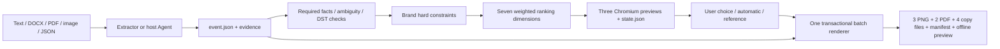

# Architecture

`schema.py` defines typed facts, sources, dates, required fields and ambiguity. `extractors` supports conservative labeled documents and evidence; optional `providers` handles explicitly authorized official OpenAI requests. `copywriting` reads the same fact projection as `renderer/templates.py`. No generated visual supplies factual text.

`eventcraft/data/style-profiles.json` ships inside wheels. Human-readable configurations are mirrored in `assets/styles`. `scripts/build_design_assets.py` regenerates both from authored definitions. CSS is package data. Styles are never fetched from the internet. Ranking config and content are hashed for reproducibility.

`recommendation` scores all ten profiles after hard exclusions. `state.py` binds the displayed numbered list to the event digest. UI list changes are explicit page advances; selecting a style calls batch generation once. References are a design-only override, hashed and not copied. Original photos/logos are embedded as data URLs with contain.

`renderer` uses a shared synchronous Chromium lifecycle inside nested calls, isolated pages, blocked HTTP(S) routes, inline CSS and escaped HTML. The screen layouts are adapted independently for portrait, square, invitation and A4. It performs actual font measurement, shrinks text to minimum sizes, verifies DOM bounds/section collisions, checks required text, writes PNG/PDF into a temporary staging directory, then replaces generated files. Existing unrelated nonempty directories are rejected. PDF print is A4 with vector text; letter uses document flow and can paginate when necessary.

Tests use a shared real browser and isolated temporary output. Unit tests check schema/extraction/recommendation/privacy; render tests check 10×3 content variants×3 sizes, five campaigns, PDF dimensions, QR source and final poster decoding, asset preservation, custom styles and batch entry calls. No screenshot snapshots are claimed to prove subjective design quality. Included Gallery pairs and manual contact-sheet review complement automated checks.

Network provider requests are bounded, timeout at 90 seconds, never expose response bodies/keys, and require explicit authorization. Browser errors are renderer failures, not successful fallbacks. No mock output is distributed as a real API result.
