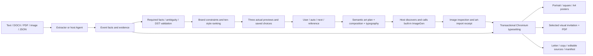

# Architecture

The existing extraction, recommendation, state, copywriting and transactional export pipeline is retained. The current visual system adds semantic art planning, shared composition and typography contracts, actual host ImageGen calls, and four independent invitation structures.

`schema.py` owns typed facts, optional QR/timezone policy and validation. `extractors` conservatively reads labeled documents with evidence; optional providers require explicit authorization. The host Agent confirms unresolved facts. Factual lettering never comes from an image model.

`recommendation` scores ten profiles after exclusions; `state.py` binds numbered choices to event facts. Bundled original artwork gives reproducible recommendation previews, explicitly distinct from fresh event art. Custom references require actual Agent inspection for composition; the CLI's palette-only analysis remains narrower.

`visuals.py` creates event-specific briefs and checks imported image bytes, style, event digest and ratio. `composition.py` computes natural reading zones before generation and uses the same normalized coordinates in the renderer. `typography.py` applies ten CJK/Latin contracts from package data. Public profiles and guides mirror the canonical design configuration; fonts are resolved from the platform, not redistributed.

Python cannot invoke a chat's image tool namespace. The installed `SKILL.md` directs the host Agent to discover the real built-in tool, call it, inspect the result and import its returned file. Missing/failed tools must be reported; fallback is reusable art and is labeled honestly. `--require-art` rejects silent fallback. Paid APIs are not the default.

`renderer/templates.py` routes to `renderer/campaigns.py`. Chromium uses inline assets, escaped text and blocked remote routes. It measures actual fonts, fits text, checks bounds and background samples, writes to staging and replaces generated files transactionally. Optional ratio-specific receipts preserve square/A4 quiet space; otherwise the full image is fitted safely. Natural dates, optional scan QR and core-only poster information share the same canonical facts with detailed invitations/copy.

Manifests record hashes, facts, fonts, bounds, image readability, composition and provenance. Campaign art and receipts export relatively for relocation. DOM and pixel checks complement actual PNG/PDF visual review; neither is an aesthetic certification. Native invitation PDFs retain their page ratio; detailed letters use A4 flow. RGB/browser printing has no CMYK or bleed calibration.

[Visual architecture](visual-architecture.md) · [Design system](design-system.md) · [Current verification](verification-visual-v3.md) · [Runtime bridge](../references/image-generation.md)
