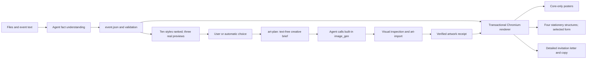

# Hybrid visual architecture

The existing extraction, schema, recommendation state, asset security, copywriting and staging architecture remain. The old simple SVG artwork path was removed from `renderer/templates.py`; that module now routes to `renderer/campaigns.py`. Ten art directions live in `data/visual-systems.json`; `composition.py` reserves title/fact zones before generation and `data/campaigns.css` integrates typography into those zones. `data/typography.json` defines native Chinese/English font roles. Bundled raster art is explicitly a reusable preview/offline fallback. Four native stationery structures live in `data/invitations.css`.

`visuals.py` supplies plans/import/hash/event binding. Python does not invoke a fake host-tool wrapper: the installed Skill directs the Agent to call the real host image tool. Built-in absence is explicitly reported. Paid APIs remain opt-in compatibility features. `--require-art` prevents silent reusable-art substitution; without it, deterministic local previews/campaigns use the bundled originals and record that provenance.

Posters have exactly two fact blocks (when/where), one title, one slogan and one CTA/QR zone. Long URLs, bullets, fees and deadlines stay in invitation/copy. Title, facts and optional CTA are transparent layers on naturally quiet image regions. DOM inspection checks collisions/clipping/broken images; actual background samples under text identify contrast problems and can refine alignment inside planned negative space. The Agent inspects, recomposes or regenerates flagged imagery. Abstract art is atmospheric and never a source of event facts.

Native invitation PNGs are 1600×800, 1600×700, 1080×1350 and 1800×1000. Poster outputs retain 1080×1920, 1080×1080 and A4. Every campaign has `invitation_print.pdf`; folded campaigns additionally include exterior/interior sources and a two-page full-spread PDF. Detailed letter remains an extra A4 output. Print PDFs retain vector text and embedded raster artwork; RGB, no CMYK/bleed/color calibration.

Generated campaigns export their art and relative receipt for replay after relocation. Manifests distinguish source-event digest, exported-event digest, semantic art digest, composition and invitation form. Numbered selection is resolved before adding a receipt/format override, preserving the original selection-state contract. Input image references are not copied; user logos/photos retain `contain` proportions.

Local tests cover existing interactions, all ten styles with three title densities, asset integrity/tampering/relocation, native shapes, QR decoded from composed posters/invitations, PDF page counts and poster simplification. Visual review complements these structural checks; palette contrast alone does not prove every possible custom image is readable.
